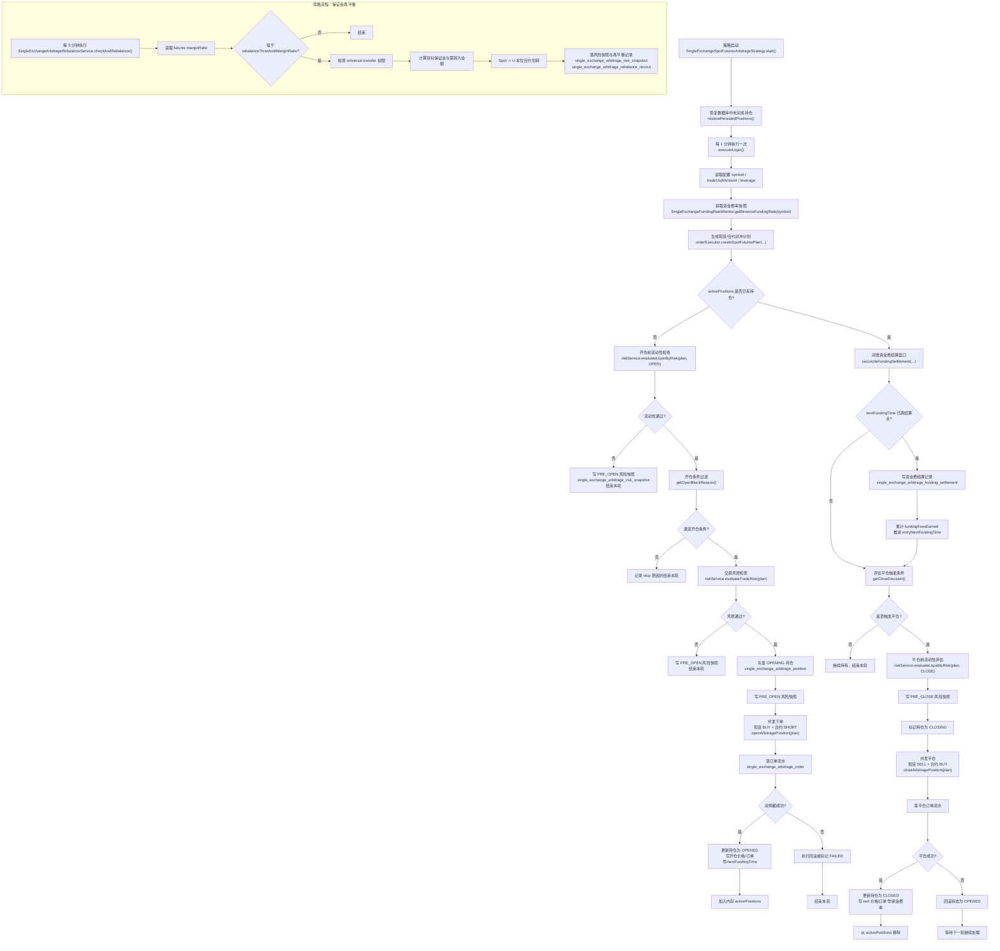

# 单交易所资金费率套利策略流程图

本文基于当前仓库已实现代码整理，主参考实现为：

- `coin-strategy-core/src/main/java/com/metaverse/coin/strategy/core/arbitrage/decision/SingleExchangeSpotFuturesArbitrageStrategy.java`
- `coin-strategy-core/src/main/java/com/metaverse/coin/strategy/core/arbitrage/execution/SingleExchangeArbitrageOrderExecutor.java`
- `coin-strategy-core/src/main/java/com/metaverse/coin/strategy/core/arbitrage/risk/SingleExchangeRiskService.java`
- `coin-strategy-core/src/main/java/com/metaverse/coin/strategy/core/arbitrage/execution/SingleExchangeArbitrageRebalanceService.java`
- `coin-strategy-job/src/main/java/com/metaverse/coin/strategy/job/service/BinanceSingleExchangeFundingRateArbitrageService.java`

## 1. 主流程图

## 2. 手动触发简化链路

当前仓库还保留了一条手动触发链路：

```mermaid
flowchart LR
    A["POST /binance/strategy/arbitrage/execute"] --> B["BinanceSingleExchangeArbitrageController"]
    B --> C["BinanceSingleExchangeFundingRateArbitrageService.executeArbitrage(...)"]
    C --> D["读取 funding rate"]
    D --> E["createSpotFuturesPlan(...)"]
    E --> F["checkTradeRisk(plan)"]
    F --> G["changeInitialLeverage(...)"]
    G --> H["openArbitragePosition(plan)"]
    H --> I["返回字符串日志给调用方"]
```

这条链路的特点：

- 适合人工调试或手工开仓。
- 当前不会像策略化主链路那样完整落库持仓、风险快照、资金费结算。
- 因此如果要描述“生产态策略生命周期”，应以 `SingleExchangeSpotFuturesArbitrageStrategy` 为准。

## 3. 关键决策点

- 开仓准入：资金费率、结算保护窗口、基差区间、预期净收益、流动性、账户余额、保证金率。
- 持仓中检查：是否跨过资金费结算点、是否需要累计 funding settlement。
- 平仓触发：资金费率转非正、低于平仓阈值、基差恶化超阈值、保证金率跌破紧急阈值。
- 失败保护：双侧任一侧失败时回滚；平仓失败则把状态恢复为 `OPENED`，等待下一轮继续退出。

## 4. 相关落库表

- `single_exchange_arbitrage_position`：持仓状态机主表。
- `single_exchange_arbitrage_order`：开仓、平仓、回滚订单流水。
- `single_exchange_arbitrage_funding_settlement`：资金费结算记录。
- `single_exchange_arbitrage_risk_snapshot`：开仓前、平仓前、再平衡检查快照。
- `single_exchange_arbitrage_rebalance_record`：自动补保证金记录。
