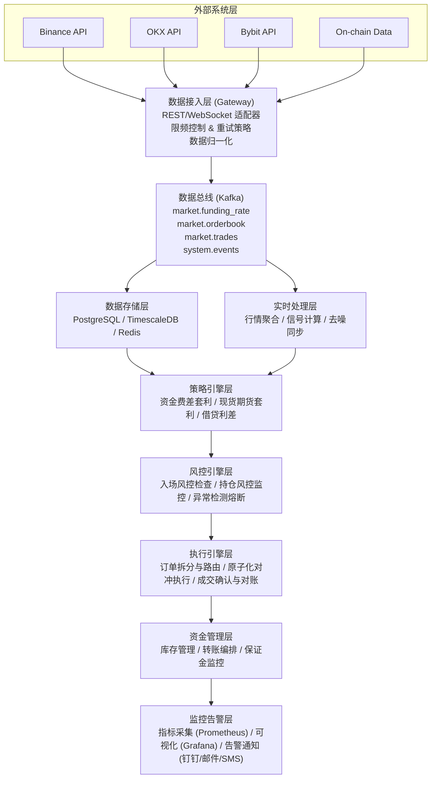
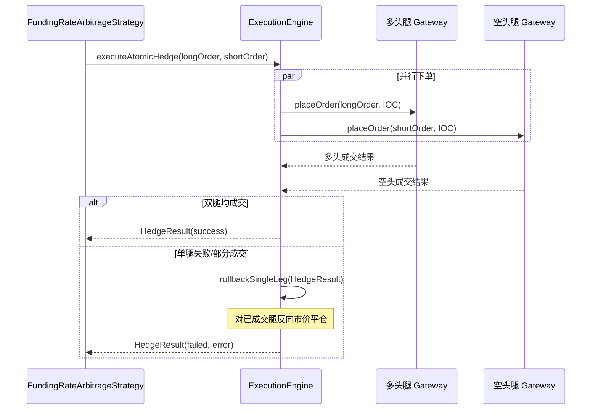

# 跨交易所资金费套利系统详细设计方案

> **【文档状态：已完成】** 本文档目录规划 7 章，正文已完成第 1–7 章（系统概述 / 架构设计 / 核心模块设计 / 接口调用设计 / 风控逻辑设计 / 数据库设计 / 部署方案）。

## 目录

1. [系统概述](#系统概述)
2. [架构设计](#架构设计)
3. [核心模块设计](#核心模块设计)
4. [接口调用设计](#接口调用设计)
5. [风控逻辑设计](#风控逻辑设计)
6. [数据库设计](#数据库设计)
7. [部署方案](#部署方案)

---

## 系统概述

### 设计目标

构建一个高可用、低延迟、风险可控的跨交易所资金费套利系统,支持:
- 多交易所实时监控(Binance, OKX, Bybit等)
- 智能信号生成与去噪
- 原子化对冲执行
- 多层级风控防护
- 完整的对账与审计

### 技术栈选型

- **后端**: Java 17 + Spring Boot 3.x
- **数据库**: PostgreSQL (事务) + TimescaleDB (时序数据)
- **缓存**: Redis (行情缓存 + 分布式锁)
- **消息队列**: Kafka (异步事件流)
- **监控**: Prometheus + Grafana
- **日志**: ELK Stack (Elasticsearch + Logstash + Kibana)

---

## 架构设计

### 总体架构图



### 分层职责说明

#### 1. 数据接入层 (Gateway Layer)

**职责**: 统一对接各交易所API,提供归一化数据流
**核心组件**:
- `ExchangeGatewayFactory`: 交易所网关工厂
- `BinanceGateway`, `OKXGateway`, `BybitGateway`: 具体交易所适配器
- `RateLimiter`: 限频控制器
- `RetryPolicy`: 重试策略管理器

#### 2. 实时处理层 (Stream Processing)

**职责**: 实时数据清洗、去噪、同步与特征工程
**核心组件**:
- `DataSynchronizer`: 多交易所数据时间对齐
- `SignalProcessor`: 信号预处理(去噪/滤波)
- `FeatureEngine`: 特征工程(资金费差/价差/深度等)
- `AnomalyDetector`: 异常检测

#### 3. 策略引擎层 (Strategy Engine)

**职责**: 策略逻辑实现与信号生成
**核心组件**:
- `FundingRateArbitrageStrategy`: 资金费差套利
- `SingleExchangeSpotFuturesArbitrageStrategy`: 单交易所现货期货套利
- `BorrowLendArbitrageStrategy`: 借贷利差套利
- `StrategyOrchestrator`: 策略编排器

#### 4. 风控引擎层 (Risk Management)

**职责**: 多层级风控防护
**核心组件**:
- `PreTradeRiskChecker`: 入场前风控
- `PositionMonitor`: 持仓实时监控
- `LiquidationGuard`: 强平防护
- `CircuitBreaker`: 熔断器

#### 5. 执行引擎层 (Execution Engine)

**职责**: 订单智能拆分与原子化对冲执行
**核心组件**:
- `OrderRouter`: 订单路由器
- `SmartOrderSplitter`: 智能订单拆分
- `AtomicHedger`: 原子化对冲执行器
- `ExecutionReporter`: 成交确认与对账

#### 6. 资金管理层 (Fund Management)

**职责**: 跨交易所资金调度与保证金管理
**核心组件**:
- `InventoryManager`: 库存管理器
- `TransferOrchestrator`: 转账编排器
- `MarginMonitor`: 保证金监控器
- `WithdrawalStateMachine`: 提现状态机

---

## 核心模块设计

### 模块1: 数据接入层详细设计

#### 1.1 交易所网关接口定义

```java
/**
 * 交易所网关统一接口
 */
public interface ExchangeGateway {
    
    /**
     * 获取资金费率信息
     * @param symbol 交易对 (如 BTCUSDT)
     * @return 资金费率数据
     */
    FundingRateData getFundingRate(String symbol);
    
    /**
     * 获取历史资金费率
     * @param symbol 交易对
     * @param startTime 开始时间
     * @param endTime 结束时间
     * @return 历史资金费率列表
     */
    List<FundingRateData> getFundingRateHistory(String symbol, long startTime, long endTime);
    
    /**
     * 获取盘口深度
     * @param symbol 交易对
     * @param limit 深度档位 (如5/10/20)
     * @return 订单簿数据
     */
    OrderBookData getOrderBook(String symbol, int limit);
    
    /**
     * 订阅实时资金费率 (WebSocket)
     * @param symbol 交易对
     * @param callback 回调函数
     */
    void subscribeFundingRate(String symbol, Consumer<FundingRateData> callback);
    
    /**
     * 订阅实时盘口 (WebSocket)
     * @param symbol 交易对
     * @param callback 回调函数
     */
    void subscribeOrderBook(String symbol, Consumer<OrderBookData> callback);
    
    /**
     * 下单
     * @param order 订单请求
     * @return 订单响应
     */
    OrderResponse placeOrder(OrderRequest order);
    
    /**
     * 批量下单
     * @param orders 订单列表
     * @return 订单响应列表
     */
    List<OrderResponse> batchPlaceOrders(List<OrderRequest> orders);
    
    /**
     * 撤单
     * @param orderId 订单ID
     * @param symbol 交易对
     */
    void cancelOrder(String orderId, String symbol);
    
    /**
     * 查询账户余额
     * @return 账户余额信息
     */
    AccountBalance getAccountBalance();
    
    /**
     * 查询持仓
     * @param symbol 交易对
     * @return 持仓信息
     */
    PositionData getPosition(String symbol);
    
    /**
     * 提现
     * @param request 提现请求
     * @return 提现响应
     */
    WithdrawResponse withdraw(WithdrawRequest request);
    
    /**
     * 查询提现状态
     * @param withdrawId 提现ID
     * @return 提现状态
     */
    WithdrawStatus getWithdrawStatus(String withdrawId);
}
```

#### 1.2 限频控制器设计

```java
/**
 * 限频控制器
 * 支持多种限频策略: 令牌桶、漏桶、滑动窗口
 */
public class RateLimiter {
    
    private final String exchange;
    private final String endpoint;
    private final int maxRequests;
    private final Duration window;
    private final Queue<Instant> requestTimes;
    private final Lock lock;
    
    public RateLimiter(String exchange, String endpoint, int maxRequests, Duration window) {
        this.exchange = exchange;
        this.endpoint = endpoint;
        this.maxRequests = maxRequests;
        this.window = window;
        this.requestTimes = new ConcurrentLinkedQueue<>();
        this.lock = new ReentrantLock();
    }
    
    /**
     * 尝试获取令牌
     * @return 是否成功
     */
    public boolean tryAcquire() {
        lock.lock();
        try {
            Instant now = Instant.now();
            Instant windowStart = now.minus(window);
            
            // 清理过期请求
            while (!requestTimes.isEmpty() && requestTimes.peek().isBefore(windowStart)) {
                requestTimes.poll();
            }
            
            // 检查是否超限
            if (requestTimes.size() < maxRequests) {
                requestTimes.offer(now);
                return true;
            }
            return false;
        } finally {
            lock.unlock();
        }
    }
    
    /**
     * 阻塞式获取令牌
     * @param timeout 超时时间
     * @return 是否成功
     */
    public boolean acquire(Duration timeout) throws InterruptedException {
        Instant deadline = Instant.now().plus(timeout);
        while (Instant.now().isBefore(deadline)) {
            if (tryAcquire()) {
                return true;
            }
            Thread.sleep(100); // 退避等待
        }
        return false;
    }
}
```

#### 1.3 Binance网关实现示例

```java
@Component
@Slf4j
public class BinanceGateway implements ExchangeGateway {
    
    private final RestTemplate restTemplate;
    private final Map<String, RateLimiter> rateLimiters;
    private final String apiKey;
    private final String secretKey;
    
    // API端点限频配置 (参考Binance文档)
    private static final Map<String, RateLimitConfig> RATE_LIMITS = Map.of(
        "/fapi/v1/fundingRate", new RateLimitConfig(500, Duration.ofMinutes(5)),
        "/fapi/v1/depth", new RateLimitConfig(50, Duration.ofSeconds(1)),
        "/fapi/v1/order", new RateLimitConfig(300, Duration.ofMinutes(1)),
        "/sapi/v1/capital/withdraw/apply", new RateLimitConfig(10, Duration.ofMinutes(1))
    );
    
    @Override
    public FundingRateData getFundingRate(String symbol) {
        String endpoint = "/fapi/v1/premiumIndex";
        RateLimiter limiter = getRateLimiter(endpoint);
        
        try {
            // 限频控制
            if (!limiter.acquire(Duration.ofSeconds(5))) {
                throw new RateLimitExceededException("Rate limit exceeded for " + endpoint);
            }
            
            // 构建请求
            String url = "https://fapi.binance.com" + endpoint + "?symbol=" + symbol;
            
            // 发起请求(带重试)
            ResponseEntity<BinanceFundingRate> response = retryTemplate.execute(ctx -> 
                restTemplate.getForEntity(url, BinanceFundingRate.class)
            );
            
            // 转换为统一数据模型
            return convertToFundingRateData(response.getBody());
            
        } catch (Exception e) {
            log.error("Failed to fetch funding rate from Binance for {}", symbol, e);
            throw new ExchangeApiException("Binance API error", e);
        }
    }
    
    @Override
    public List<FundingRateData> getFundingRateHistory(String symbol, long startTime, long endTime) {
        String endpoint = "/fapi/v1/fundingRate";
        RateLimiter limiter = getRateLimiter(endpoint);
        
        try {
            if (!limiter.acquire(Duration.ofSeconds(5))) {
                throw new RateLimitExceededException("Rate limit exceeded");
            }
            
            String url = String.format(
                "https://fapi.binance.com%s?symbol=%s&startTime=%d&endTime=%d&limit=1000",
                endpoint, symbol, startTime, endTime
            );
            
            ResponseEntity<List<BinanceFundingRate>> response = retryTemplate.execute(ctx ->
                restTemplate.exchange(url, HttpMethod.GET, null, 
                    new ParameterizedTypeReference<List<BinanceFundingRate>>() {})
            );
            
            return response.getBody().stream()
                .map(this::convertToFundingRateData)
                .collect(Collectors.toList());
                
        } catch (Exception e) {
            log.error("Failed to fetch funding rate history from Binance", e);
            throw new ExchangeApiException("Binance API error", e);
        }
    }
    
    @Override
    public OrderBookData getOrderBook(String symbol, int limit) {
        String endpoint = "/fapi/v1/depth";
        RateLimiter limiter = getRateLimiter(endpoint);
        
        try {
            if (!limiter.acquire(Duration.ofSeconds(2))) {
                throw new RateLimitExceededException("Rate limit exceeded");
            }
            
            String url = String.format(
                "https://fapi.binance.com%s?symbol=%s&limit=%d",
                endpoint, symbol, limit
            );
            
            ResponseEntity<BinanceOrderBook> response = retryTemplate.execute(ctx ->
                restTemplate.getForEntity(url, BinanceOrderBook.class)
            );
            
            return convertToOrderBookData(response.getBody());
            
        } catch (Exception e) {
            log.error("Failed to fetch order book from Binance", e);
            throw new ExchangeApiException("Binance API error", e);
        }
    }
    
    @Override
    public OrderResponse placeOrder(OrderRequest order) {
        String endpoint = "/fapi/v1/order";
        RateLimiter limiter = getRateLimiter(endpoint);
        
        try {
            if (!limiter.acquire(Duration.ofSeconds(2))) {
                throw new RateLimitExceededException("Rate limit exceeded");
            }
            
            // 构建签名请求
            Map<String, String> params = buildOrderParams(order);
            String signature = generateSignature(params, secretKey);
            params.put("signature", signature);
            
            HttpHeaders headers = new HttpHeaders();
            headers.set("X-MBX-APIKEY", apiKey);
            
            String url = "https://fapi.binance.com" + endpoint;
            HttpEntity<Map<String, String>> request = new HttpEntity<>(params, headers);
            
            ResponseEntity<BinanceOrderResponse> response = retryTemplate.execute(ctx ->
                restTemplate.postForEntity(url, request, BinanceOrderResponse.class)
            );
            
            return convertToOrderResponse(response.getBody());
            
        } catch (Exception e) {
            log.error("Failed to place order on Binance", e);
            throw new ExchangeApiException("Binance order failed", e);
        }
    }
    
    private RateLimiter getRateLimiter(String endpoint) {
        return rateLimiters.computeIfAbsent(endpoint, ep -> {
            RateLimitConfig config = RATE_LIMITS.get(ep);
            return new RateLimiter("binance", ep, config.maxRequests, config.window);
        });
    }
    
    // 数据转换方法...
}
```

### 模块2: 信号处理引擎

#### 2.1 数据同步器设计

```java
/**
 * 多交易所数据时间对齐器
 * 将不同交易所的数据对齐到统一的结算窗口
 */
@Component
@Slf4j
public class DataSynchronizer {
    
    private final Map<String, FundingSettlement> settlementSchedules;
    
    /**
     * 对齐到下一个结算窗口
     */
    public SyncedMarketData alignToSettlement(List<MarketSnapshot> snapshots) {
        // 找到最近的公共结算时间
        Instant nextSettlement = findNextCommonSettlement(snapshots);
        
        // 按交易所分组
        Map<String, MarketSnapshot> byExchange = snapshots.stream()
            .collect(Collectors.toMap(MarketSnapshot::getExchange, s -> s));
        
        // 检查数据时效性
        Instant now = Instant.now();
        for (MarketSnapshot snapshot : snapshots) {
            Duration lag = Duration.between(snapshot.getTimestamp(), now);
            if (lag.toMillis() > 5000) { // 超过5秒视为过期
                log.warn("Stale data from {}: lag={}ms", snapshot.getExchange(), lag.toMillis());
            }
        }
        
        return SyncedMarketData.builder()
            .settlementTime(nextSettlement)
            .snapshots(byExchange)
            .syncTimestamp(now)
            .build();
    }
    
    /**
     * 查找下一个公共结算时间
     */
    private Instant findNextCommonSettlement(List<MarketSnapshot> snapshots) {
        // 获取每个交易所的下一次结算时间
        List<Instant> nextSettlements = snapshots.stream()
            .map(s -> {
                FundingSettlement schedule = settlementSchedules.get(s.getExchange());
                return schedule.getNextSettlement(s.getSymbol());
            })
            .collect(Collectors.toList());
        
        // 找到最近的公共时间(所有交易所都会结算的时间)
        return nextSettlements.stream()
            .max(Comparator.naturalOrder())
            .orElseThrow();
    }
}
```

#### 2.2 信号去噪与滤波

```java
/**
 * 信号处理器 - 去噪与滤波
 */
@Component
public class SignalProcessor {
    
    /**
     * Hampel滤波器 - 去除异常值
     */
    public List<Double> hampelFilter(List<Double> data, int windowSize, double nSigma) {
        List<Double> filtered = new ArrayList<>();
        
        for (int i = 0; i < data.size(); i++) {
            int start = Math.max(0, i - windowSize / 2);
            int end = Math.min(data.size(), i + windowSize / 2 + 1);
            List<Double> window = data.subList(start, end);
            
            // 计算中位数和MAD
            double median = calculateMedian(window);
            double mad = calculateMAD(window, median);
            
            double value = data.get(i);
            double zScore = Math.abs((value - median) / (1.4826 * mad));
            
            // 如果超过阈值,用中位数替换
            if (zScore > nSigma) {
                filtered.add(median);
                log.debug("Outlier detected at index {}: value={}, median={}", i, value, median);
            } else {
                filtered.add(value);
            }
        }
        
        return filtered;
    }
    
    /**
     * 指数移动平均(EMA)滤波
     */
    public List<Double> emaFilter(List<Double> data, double alpha) {
        List<Double> ema = new ArrayList<>();
        
        if (data.isEmpty()) return ema;
        
        ema.add(data.get(0)); // 第一个值直接使用
        
        for (int i = 1; i < data.size(); i++) {
            double value = alpha * data.get(i) + (1 - alpha) * ema.get(i - 1);
            ema.add(value);
        }
        
        return ema;
    }
    
    /**
     * Winsorize - 截尾处理
     */
    public List<Double> winsorize(List<Double> data, double lowerPercentile, double upperPercentile) {
        List<Double> sorted = new ArrayList<>(data);
        Collections.sort(sorted);
        
        int lowerIndex = (int) (data.size() * lowerPercentile);
        int upperIndex = (int) (data.size() * upperPercentile);
        
        double lowerBound = sorted.get(lowerIndex);
        double upperBound = sorted.get(upperIndex);
        
        return data.stream()
            .map(v -> Math.max(lowerBound, Math.min(upperBound, v)))
            .collect(Collectors.toList());
    }
    
    /**
     * 卡尔曼滤波 (简化版)
     */
    public List<Double> kalmanFilter(List<Double> data, double processNoise, double measurementNoise) {
        List<Double> filtered = new ArrayList<>();
        
        if (data.isEmpty()) return filtered;
        
        double estimate = data.get(0);
        double errorCovariance = 1.0;
        
        for (double measurement : data) {
            // 预测
            double predictedEstimate = estimate;
            double predictedErrorCovariance = errorCovariance + processNoise;
            
            // 更新
            double kalmanGain = predictedErrorCovariance / (predictedErrorCovariance + measurementNoise);
            estimate = predictedEstimate + kalmanGain * (measurement - predictedEstimate);
            errorCovariance = (1 - kalmanGain) * predictedErrorCovariance;
            
            filtered.add(estimate);
        }
        
        return filtered;
    }
    
    private double calculateMedian(List<Double> values) {
        List<Double> sorted = new ArrayList<>(values);
        Collections.sort(sorted);
        int size = sorted.size();
        return size % 2 == 0 
            ? (sorted.get(size/2 - 1) + sorted.get(size/2)) / 2.0
            : sorted.get(size/2);
    }
    
    private double calculateMAD(List<Double> values, double median) {
        List<Double> deviations = values.stream()
            .map(v -> Math.abs(v - median))
            .collect(Collectors.toList());
        return calculateMedian(deviations);
    }
}
```

#### 2.3 特征工程引擎

```java
/**
 * 特征工程引擎
 */
@Component
public class FeatureEngine {
    
    private final SignalProcessor signalProcessor;
    
    /**
     * 计算资金费差特征
     */
    public FundingDiffFeatures calculateFundingDiffFeatures(
            SyncedMarketData syncedData, 
            String symbolA, 
            String symbolB) {
        
        MarketSnapshot snapshotA = syncedData.getSnapshot("binance");
        MarketSnapshot snapshotB = syncedData.getSnapshot("okx");
        
        // 原始资金费差
        double rawDiff = snapshotA.getFundingRate() - snapshotB.getFundingRate();
        
        // 去噪后的资金费差 (使用历史数据)
        List<Double> historicalDiff = fetchHistoricalDiff(symbolA, symbolB, 100);
        List<Double> filtered = signalProcessor.hampelFilter(historicalDiff, 10, 3.0);
        double smoothedDiff = filtered.get(filtered.size() - 1);
        
        // Z-score标准化
        double mean = calculateMean(historicalDiff);
        double std = calculateStd(historicalDiff, mean);
        double zScore = (rawDiff - mean) / std;
        
        // 持续性指标 (自相关)
        double persistence = calculateAutocorrelation(historicalDiff, 1);
        
        return FundingDiffFeatures.builder()
            .rawDiff(rawDiff)
            .smoothedDiff(smoothedDiff)
            .zScore(zScore)
            .persistence(persistence)
            .mean(mean)
            .std(std)
            .build();
    }
    
    /**
     * 计算价差特征
     */
    public SpreadFeatures calculateSpreadFeatures(SyncedMarketData syncedData) {
        MarketSnapshot snapshotA = syncedData.getSnapshot("binance");
        MarketSnapshot snapshotB = syncedData.getSnapshot("okx");
        
        double priceA = snapshotA.getMarkPrice();
        double priceB = snapshotB.getMarkPrice();
        
        // 对数价差
        double logSpread = Math.log(priceA / priceB);
        
        // 价差ATR
        List<Double> historicalSpread = fetchHistoricalSpread(100);
        double atr = calculateATR(historicalSpread, 14);
        
        // 价差Z-score
        double mean = calculateMean(historicalSpread);
        double std = calculateStd(historicalSpread, mean);
        double zScore = (logSpread - mean) / std;
        
        return SpreadFeatures.builder()
            .logSpread(logSpread)
            .atr(atr)
            .zScore(zScore)
            .build();
    }
    
    /**
     * 计算流动性特征
     */
    public LiquidityFeatures calculateLiquidityFeatures(MarketSnapshot snapshot, double targetQty) {
        OrderBookData orderBook = snapshot.getOrderBook();
        
        // 计算买一卖一点差
        double spread = orderBook.getAskPrice(0) - orderBook.getBidPrice(0);
        double midPrice = (orderBook.getAskPrice(0) + orderBook.getBidPrice(0)) / 2.0;
        double spreadBps = (spread / midPrice) * 10000;
        
        // 计算深度(目标数量对应的VWAP)
        double buyVWAP = calculateVWAP(orderBook.getAsks(), targetQty);
        double sellVWAP = calculateVWAP(orderBook.getBids(), targetQty);
        
        // 计算冲击成本
        double buyImpact = ((buyVWAP - midPrice) / midPrice) * 10000; // bps
        double sellImpact = ((midPrice - sellVWAP) / midPrice) * 10000;
        
        return LiquidityFeatures.builder()
            .spreadBps(spreadBps)
            .buyVWAP(buyVWAP)
            .sellVWAP(sellVWAP)
            .buyImpact(buyImpact)
            .sellImpact(sellImpact)
            .build();
    }
    
    /**
     * 计算VWAP
     */
    private double calculateVWAP(List<PriceLevel> levels, double targetQty) {
        double totalValue = 0.0;
        double totalQty = 0.0;
        
        for (PriceLevel level : levels) {
            double qty = Math.min(level.getQuantity(), targetQty - totalQty);
            totalValue += level.getPrice() * qty;
            totalQty += qty;
            
            if (totalQty >= targetQty) break;
        }
        
        return totalQty > 0 ? totalValue / totalQty : 0.0;
    }
    
    /**
     * 计算ATR
     */
    private double calculateATR(List<Double> prices, int period) {
        List<Double> trueRanges = new ArrayList<>();
        
        for (int i = 1; i < prices.size(); i++) {
            double high = Math.max(prices.get(i), prices.get(i-1));
            double low = Math.min(prices.get(i), prices.get(i-1));
            double tr = high - low;
            trueRanges.add(tr);
        }
        
        // 取最后period个的平均
        int start = Math.max(0, trueRanges.size() - period);
        List<Double> recent = trueRanges.subList(start, trueRanges.size());
        return calculateMean(recent);
    }
    
    // 统计计算辅助方法...
}
```

### 模块3: 策略引擎设计

```java
/**
 * 资金费差套利策略
 */
@Component
@Slf4j
public class FundingRateArbitrageStrategy implements Strategy {
    
    private final FeatureEngine featureEngine;
    private final SingleExchangeRiskService riskController;
    private final ExecutionEngine executionEngine;
    private final StrategyConfig config;
    
    @Override
    public void onMarketData(SyncedMarketData marketData) {
        String symbol = "BTCUSDT";
        
        // 1. 计算特征
        FundingDiffFeatures fundingFeatures = featureEngine.calculateFundingDiffFeatures(
            marketData, "binance", "okx");
        
        SpreadFeatures spreadFeatures = featureEngine.calculateSpreadFeatures(marketData);
        
        MarketSnapshot binanceSnapshot = marketData.getSnapshot("binance");
        MarketSnapshot okxSnapshot = marketData.getSnapshot("okx");
        
        LiquidityFeatures binanceLiquidity = featureEngine.calculateLiquidityFeatures(
            binanceSnapshot, config.getTargetQty());
        LiquidityFeatures okxLiquidity = featureEngine.calculateLiquidityFeatures(
            okxSnapshot, config.getTargetQty());
        
        // 2. 计算期望净收益
        double expectedReturn = calculateExpectedReturn(
            fundingFeatures, spreadFeatures, binanceLiquidity, okxLiquidity);
        
        // 3. 决策逻辑
        if (shouldOpenPosition(fundingFeatures, spreadFeatures, expectedReturn)) {
            // 开仓
            openPosition(binanceSnapshot, okxSnapshot, fundingFeatures);
        } else if (shouldClosePosition(fundingFeatures, spreadFeatures)) {
            // 平仓
            closePosition();
        }
    }
    
    /**
     * 计算期望净收益
     */
    private double calculateExpectedReturn(
            FundingDiffFeatures fundingFeatures,
            SpreadFeatures spreadFeatures,
            LiquidityFeatures liquidityA,
            LiquidityFeatures liquidityB) {
        
        // 资金费差现金流
        double fundingCashflow = fundingFeatures.getRawDiff() * config.getNotional();
        
        // 手续费成本
        double feeCost = calculateFeeCost(liquidityA, liquidityB);
        
        // 滑点成本
        double slippageCost = calculateSlippageCost(liquidityA, liquidityB);
        
        // 借贷成本 (如适用): 若某一腿采用现货杠杆借币, 借入腿按小时计提借贷利息;
        // 若双腿均为永续合约则无借币需求, 借贷成本为 0
        double borrowCost = calculateBorrowCost(config.getNotional(), config.getExpectedHoldingHours());
        
        // 转账成本 (如需要跨交易所/跨链调拨): 仅当需在交易所间转移资金以再平衡保证金时产生,
        // 估算 = 提现手续费 + 链上 gas, 并按本次套利周期摊销
        double transferCost = estimateTransferCost(config.getNotional());
        
        // 价差风险 (预期价差变化的PnL)
        double spreadRisk = estimateSpreadRisk(spreadFeatures);
        
        // 期望净收益
        double expectedReturn = fundingCashflow - feeCost - slippageCost - borrowCost - transferCost + spreadRisk;
        
        log.info("Expected Return Breakdown: funding={}, fee={}, slip={}, borrow={}, transfer={}, spread={}, net={}",
            fundingCashflow, feeCost, slippageCost, borrowCost, transferCost, spreadRisk, expectedReturn);
        
        return expectedReturn;
    }
    
    /**
     * 开仓条件判断
     */
    private boolean shouldOpenPosition(
            FundingDiffFeatures fundingFeatures,
            SpreadFeatures spreadFeatures,
            double expectedReturn) {
        
        // 条件1: 期望收益大于阈值
        if (expectedReturn / config.getNotional() < config.getOpenThreshold()) {
            log.debug("Expected return too low: {}", expectedReturn);
            return false;
        }
        
        // 条件2: 资金费差Z-score足够大
        if (Math.abs(fundingFeatures.getZScore()) < 2.0) {
            log.debug("Funding diff z-score too low: {}", fundingFeatures.getZScore());
            return false;
        }
        
        // 条件3: 价差在合理范围内
        if (Math.abs(spreadFeatures.getZScore()) > 3.0) {
            log.debug("Spread z-score too extreme: {}", spreadFeatures.getZScore());
            return false;
        }
        
        // 条件4: 资金费持续性检查
        if (fundingFeatures.getPersistence() < 0.3) {
            log.debug("Funding rate not persistent enough: {}", fundingFeatures.getPersistence());
            return false;
        }
        
        return true;
    }
    
    /**
     * 平仓条件判断
     */
    private boolean shouldClosePosition(
            FundingDiffFeatures fundingFeatures,
            SpreadFeatures spreadFeatures) {
        
        // 条件1: 资金费差回归
        if (Math.abs(fundingFeatures.getRawDiff()) < config.getCloseThreshold()) {
            log.info("Funding diff converged, closing position");
            return true;
        }
        
        // 条件2: 资金费转负 (如果是做空高费率)
        // 若当前持仓的空头腿是为收取正资金费而开, 而该腿资金费率已翻为负值
        // (即持仓将转为支付资金费), 则触发平仓
        ArbitragePosition currentPosition = positionStore.getCurrentPosition("BTCUSDT");
        if (currentPosition != null && currentPosition.isOpen()) {
            String shortExchange = currentPosition.getShortExchange();
            double shortLegFundingRate = "binance".equals(shortExchange)
                ? fundingFeatures.getBinanceFundingRate()
                : fundingFeatures.getOkxFundingRate();
            // 开仓时空头腿资金费为正 (收费), 现已翻负 (变为付费) -> 套利逻辑反转, 平仓
            if (currentPosition.getOpenShortFundingRate() > 0 && shortLegFundingRate < 0) {
                log.info("Short leg funding rate flipped negative ({} -> {}), closing position",
                    currentPosition.getOpenShortFundingRate(), shortLegFundingRate);
                return true;
            }
        }
        
        // 条件3: 价差止损
        if (Math.abs(spreadFeatures.getZScore()) > 4.0) {
            log.warn("Spread diverged too much, stop loss triggered");
            return true;
        }
        
        return false;
    }
    
    /**
     * 开仓执行
     */
    private void openPosition(
            MarketSnapshot snapshotA,
            MarketSnapshot snapshotB,
            FundingDiffFeatures fundingFeatures) {
        
        // 风控检查
        RiskCheckResult riskCheck = riskController.checkPreTradeRisk(
            "binance", "okx", config.getNotional());
        
        if (!riskCheck.isPassed()) {
            log.warn("Risk check failed: {}", riskCheck.getReason());
            return;
        }
        
        // 确定开仓方向
        String longExchange = fundingFeatures.getRawDiff() > 0 ? "okx" : "binance";
        String shortExchange = fundingFeatures.getRawDiff() > 0 ? "binance" : "okx";
        
        // 构建订单
        OrderRequest longOrder = OrderRequest.builder()
            .exchange(longExchange)
            .symbol("BTCUSDT")
            .side("BUY")
            .type("LIMIT")
            .quantity(config.getTargetQty())
            .price(getBestBidPrice(longExchange))
            .timeInForce("IOC") // 立即成交或取消
            .build();
        
        OrderRequest shortOrder = OrderRequest.builder()
            .exchange(shortExchange)
            .symbol("BTCUSDT")
            .side("SELL")
            .type("LIMIT")
            .quantity(config.getTargetQty())
            .price(getBestAskPrice(shortExchange))
            .timeInForce("IOC")
            .build();
        
        // 原子化对冲执行
        try {
            HedgeResult result = executionEngine.executeAtomicHedge(longOrder, shortOrder);
            
            if (result.isSuccess()) {
                log.info("Position opened successfully: {}", result);
            } else {
                log.error("Failed to open position: {}", result.getError());
                // 回滚已成交的单腿
                executionEngine.rollbackSingleLeg(result);
            }
        } catch (Exception e) {
            log.error("Exception during position opening", e);
        }
    }
    
    // 其他辅助方法...
}
```

---

## 第4章 接口调用设计

本章描述 `BinanceGateway` / `OKXGateway` 在下单、撤单、查询场景下的接口调用时序、关键参数、限频与错误码处理，以及对冲双腿下单的时序编排与单腿失败回滚。

### 4.1 交易接口对照

两家交易所的核心交易端点差异如下，`ExchangeGateway` 在适配层屏蔽差异：

| 能力 | Binance (USDⓈ-M Futures) | OKX (V5) |
| --- | --- | --- |
| 下单 | `POST /fapi/v1/order` | `POST /api/v5/trade/order` |
| 撤单 | `DELETE /fapi/v1/order` | `POST /api/v5/trade/cancel-order` |
| 查询订单 | `GET /fapi/v1/order` | `GET /api/v5/trade/order` |
| 查询持仓 | `GET /fapi/v2/positionRisk` | `GET /api/v5/account/positions` |
| 鉴权方式 | HMAC-SHA256，`X-MBX-APIKEY` + `signature` | HMAC-SHA256，`OK-ACCESS-SIGN` + `OK-ACCESS-TIMESTAMP` + `OK-ACCESS-PASSPHRASE` |
| 客户端订单号 | `newClientOrderId` | `clOrdId` |

### 4.2 下单调用时序

单腿下单遵循「限频 → 构建签名请求 → 发送 → 解析响应 → 落库」流程，与第 3 章 `BinanceGateway.placeOrder` 一致：

1. 通过 `RateLimiter.acquire` 获取该端点令牌，未获取到则抛出 `RateLimitExceededException`，交由上层退避；
2. 由 `OrderRequest` 构建参数，强制写入幂等键 `clientOrderId`（见 4.4），生成签名；
3. 发送 HTTP 请求，由 `retryTemplate` 包裹（重试策略见 4.4）；
4. 解析为统一 `OrderResponse`，写入 `arb_order` 表（见第 6 章），状态置为 `SUBMITTED`。

### 4.3 限频与错误码处理

`RateLimiter` 已在客户端侧做软限频，但仍需识别交易所返回的硬限频与业务错误，区分「可重试」与「不可重试」：

| 分类 | Binance | OKX | 处理策略 |
| --- | --- | --- | --- |
| 限频 | HTTP 429 / 418，`-1003` | `50011` | 退避后重试，读取 `Retry-After` |
| 鉴权失败 | `-2014` / `-1022` | `50113` / `50114` | 不可重试，触发告警 |
| 参数错误 | `-1100` / `-4003` | `51000` 系列 | 不可重试，丢弃信号 |
| 余额/保证金不足 | `-2019` | `51008` | 不可重试，转资金管理层 |
| 订单不存在 | `-2013` | `51603` | 撤单/查询时视为终态，幂等返回 |
| 系统繁忙/超时 | `-1001` | `50001` / 网关 5xx | 可重试 |

```java
public boolean isRetryable(ExchangeApiException e) {
    int code = e.getErrorCode();
    // 限频、系统繁忙、网关超时可重试; 鉴权/参数/余额类错误不可重试
    return RETRYABLE_CODES.contains(code) || e.isTimeout();
}
```

### 4.4 幂等与重试策略

- **幂等键**：每个 `OrderRequest` 在进入网关前生成全局唯一 `clientOrderId`（格式 `{strategyId}-{signalId}-{leg}`），映射到 Binance `newClientOrderId` / OKX `clOrdId`。重试时复用同一键，交易所对重复 `clientOrderId` 返回原订单，避免重复成交。
- **重试策略**：`retryTemplate` 采用指数退避（初始 200ms，倍率 2，最多 3 次，上限 2s），仅对 4.3 中「可重试」分类生效。
- **超时不确定态**：下单请求超时但未收到响应时，不直接重试，先以 `clientOrderId` 调用查询接口确认订单是否已存在，存在则视为成功，不存在再重试。

### 4.5 对冲双腿下单时序与单腿回滚

对冲开仓由 `ExecutionEngine.executeAtomicHedge(longOrder, shortOrder)` 编排，两腿均使用 `IOC` 限价单以控制滑点：



- **并行下单**：两腿并行提交以缩小敞口窗口；`IOC` 保证未即时成交部分自动取消，不留挂单。
- **单腿失败回滚**：若一腿成功、另一腿失败或仅部分成交，`executeAtomicHedge` 返回失败，由策略调用 `executionEngine.rollbackSingleLeg(result)`，对已成交腿按成交量反向市价平仓，将净敞口收敛为 0。
- **回滚兜底**：回滚下单本身失败时，写入 `system.events` 并升级为人工介入告警，同时由风控层熔断该标的（见第 5 章）。

---

## 第5章 风控逻辑设计

风控贯穿入场前、持仓中、异常时三个阶段。入场前检查由 `SingleExchangeRiskService.checkPreTradeRisk` 承担，并被 `FundingRateArbitrageStrategy.openPosition` 直接调用。

### 5.1 仓位限额

限额分三个层级，任一超限即拒绝开仓：

| 层级 | 限额维度 | 说明 |
| --- | --- | --- |
| 单标的 | `maxNotionalPerSymbol` | 单个交易对（BTCUSDT）双腿名义本金上限 |
| 总敞口 | `maxTotalNotional` | 所有标的、所有策略合计名义本金上限 |
| 单交易所 | `maxNotionalPerExchange` | 单一交易所持仓上限，防止单点风险与提现额度受限 |

`checkPreTradeRisk` 在新增名义本金后做三层校验：

```java
public RiskCheckResult checkPreTradeRisk(String longExchange, String shortExchange, double notional) {
    // 1. 单标的限额
    if (positionStore.getSymbolNotional("BTCUSDT") + notional > config.getMaxNotionalPerSymbol()) {
        return RiskCheckResult.reject("单标的名义本金超限");
    }
    // 2. 总敞口限额
    if (positionStore.getTotalNotional() + notional > config.getMaxTotalNotional()) {
        return RiskCheckResult.reject("总敞口超限");
    }
    // 3. 单交易所限额 (双腿各占一侧)
    for (String ex : List.of(longExchange, shortExchange)) {
        if (positionStore.getExchangeNotional(ex) + notional > config.getMaxNotionalPerExchange()) {
            return RiskCheckResult.reject("单交易所名义本金超限: " + ex);
        }
    }
    // 4. 滑点与保证金检查 (见 5.2 / 5.4)
    return RiskCheckResult.pass();
}
```

### 5.2 滑点保护

下单前以 `FeatureEngine.calculateLiquidityFeatures` 估算双腿冲击成本（`buyImpact` / `sellImpact`，单位 bps）。`checkPreTradeRisk` 校验合计滑点不得超过 `maxSlippageBps`，并要求扣除滑点后的期望净收益仍为正；执行时双腿均使用 `IOC` 限价单，限价为最优价加 `slippageGuardBps` 容差，超出即放弃成交而非成交在劣价。

### 5.3 敞口监控（双腿 delta 偏移）

对冲应保持双腿数量对称、净 delta 接近 0。`PositionMonitor` 周期性比对两腿成交量：

- `deltaOffset = |longFilledQty − shortFilledQty| / targetQty`；
- `deltaOffset` 超过 `deltaWarnThreshold`（如 1%）告警；
- 超过 `deltaHardThreshold`（如 3%）自动对偏多一侧补单或减仓，将敞口收敛。

部分成交、回滚失败、单腿强平均会引入 delta 偏移，故敞口监控是回滚机制之外的持续兜底。

### 5.4 熔断规则

`CircuitBreaker` 在以下任一条件触发，触发后暂停该标的开仓并保留平仓能力：

| 熔断条件 | 阈值示例 | 动作 |
| --- | --- | --- |
| 连续下单失败 | 连续 5 次 | 暂停开仓 5 分钟，告警 |
| 异常价差 | `SpreadFeatures.zScore > 4` | 暂停开仓，已有持仓走价差止损 |
| 接口不可用 | 单交易所连续超时/5xx ≥ 10 次 | 熔断该交易所相关策略 |
| 敞口失控 | `deltaOffset > deltaHardThreshold` 且补单失败 | 熔断并升级人工介入 |

熔断状态进入冷却期后做半开探测，探测成功才恢复。所有触发与恢复均写入审计/事件表（见第 6 章），并接入告警通道。

---

## 第6章 数据库设计

事务性数据存于 PostgreSQL，时序行情存于 TimescaleDB。表名统一使用 snake_case，并以 `arb_` 前缀归类。

### 6.1 套利信号表 `arb_signal`

记录每次特征计算产出的信号及决策结果。

```sql
CREATE TABLE arb_signal (
    id              BIGSERIAL    PRIMARY KEY,
    signal_id       VARCHAR(64)  NOT NULL UNIQUE,        -- 全局信号ID
    symbol          VARCHAR(32)  NOT NULL,               -- BTCUSDT
    long_exchange   VARCHAR(16)  NOT NULL,               -- 多头腿交易所
    short_exchange  VARCHAR(16)  NOT NULL,               -- 空头腿交易所
    funding_diff    NUMERIC(18,10) NOT NULL,             -- 资金费差 rawDiff
    funding_zscore  NUMERIC(12,6),                       -- 资金费差 Z-score
    spread_zscore   NUMERIC(12,6),                       -- 价差 Z-score
    expected_return NUMERIC(20,8),                       -- 期望净收益
    decision        VARCHAR(16)  NOT NULL,               -- OPEN / CLOSE / SKIP
    decision_reason VARCHAR(256),
    created_at      TIMESTAMPTZ  NOT NULL DEFAULT now()
);
CREATE INDEX idx_arb_signal_symbol_time ON arb_signal (symbol, created_at DESC);
```

### 6.2 订单表 `arb_order`

记录双腿每一笔订单，`client_order_id` 即第 4 章幂等键。

```sql
CREATE TABLE arb_order (
    id               BIGSERIAL    PRIMARY KEY,
    client_order_id  VARCHAR(64)  NOT NULL UNIQUE,       -- 幂等键
    signal_id        VARCHAR(64)  NOT NULL REFERENCES arb_signal(signal_id),
    exchange         VARCHAR(16)  NOT NULL,
    exchange_order_id VARCHAR(64),                       -- 交易所返回订单ID
    symbol           VARCHAR(32)  NOT NULL,
    leg              VARCHAR(8)   NOT NULL,              -- LONG / SHORT
    side             VARCHAR(8)   NOT NULL,              -- BUY / SELL
    order_type       VARCHAR(16)  NOT NULL,             -- LIMIT / MARKET
    price            NUMERIC(20,8),
    quantity         NUMERIC(20,8) NOT NULL,
    filled_quantity  NUMERIC(20,8) NOT NULL DEFAULT 0,
    avg_fill_price   NUMERIC(20,8),
    fee              NUMERIC(20,8) NOT NULL DEFAULT 0,
    status           VARCHAR(16)  NOT NULL,             -- SUBMITTED/FILLED/PARTIAL/CANCELED/FAILED
    error_code       VARCHAR(32),
    created_at       TIMESTAMPTZ  NOT NULL DEFAULT now(),
    updated_at       TIMESTAMPTZ  NOT NULL DEFAULT now()
);
CREATE INDEX idx_arb_order_signal ON arb_order (signal_id);
CREATE INDEX idx_arb_order_status ON arb_order (status);
```

### 6.3 对账表 `arb_reconciliation`

每个对冲周期一行，由 `ExecutionReporter` 比对本地订单与交易所成交、持仓与资金费收支。

```sql
CREATE TABLE arb_reconciliation (
    id                  BIGSERIAL    PRIMARY KEY,
    signal_id           VARCHAR(64)  NOT NULL,
    symbol              VARCHAR(32)  NOT NULL,
    long_filled_qty     NUMERIC(20,8) NOT NULL,
    short_filled_qty    NUMERIC(20,8) NOT NULL,
    delta_offset        NUMERIC(12,8) NOT NULL,         -- 双腿 delta 偏移
    realized_funding    NUMERIC(20,8) NOT NULL DEFAULT 0,-- 实收资金费
    total_fee           NUMERIC(20,8) NOT NULL DEFAULT 0,
    realized_pnl        NUMERIC(20,8),
    recon_status        VARCHAR(16)  NOT NULL,          -- MATCHED / MISMATCH
    mismatch_detail     VARCHAR(512),
    reconciled_at       TIMESTAMPTZ  NOT NULL DEFAULT now()
);
CREATE INDEX idx_arb_recon_status ON arb_reconciliation (recon_status, reconciled_at DESC);
```

### 6.4 审计/事件表 `arb_event`

记录风控触发、熔断、回滚、人工介入等系统事件，对应 Kafka `system.events`。

| 字段 | 类型 | 说明 |
| --- | --- | --- |
| `id` | BIGSERIAL | 主键 |
| `event_id` | VARCHAR(64) | 事件唯一ID |
| `event_type` | VARCHAR(32) | RISK_REJECT / CIRCUIT_BREAK / ROLLBACK / MANUAL_INTERVENE |
| `severity` | VARCHAR(16) | INFO / WARN / CRITICAL |
| `symbol` | VARCHAR(32) | 关联标的 |
| `ref_id` | VARCHAR(64) | 关联 signal_id 或 order 的 client_order_id |
| `payload` | JSONB | 事件上下文明细 |
| `created_at` | TIMESTAMPTZ | 发生时间 |

`arb_event` 按 `created_at` 做月度分区，并以 `(event_type, severity)` 建索引支撑告警查询与审计回溯。

---

## 第7章 部署方案

### 7.1 服务拓扑

系统按第 2 章分层拆分为独立可伸缩的服务，统一容器化并由 Kubernetes 编排：

| 服务 | 职责 | 实例数 | 伸缩策略 |
| --- | --- | --- | --- |
| `gateway-service` | 数据接入层，对接 Binance/OKX | 2（主备） | 固定，按交易所分片 |
| `stream-service` | 实时处理层，特征工程 | 2–4 | 按 Kafka 分区水平扩展 |
| `strategy-service` | 策略引擎，运行 `FundingRateArbitrageStrategy` | 1（主）+1（热备） | 主备，单写防重复下单 |
| `execution-service` | 执行引擎与风控，`ExecutionEngine` / `SingleExchangeRiskService` | 1（主）+1（热备） | 主备 |
| `fund-service` | 资金管理层，转账与保证金监控 | 1 | 固定 |

`strategy-service` 与 `execution-service` 通过 Redis 分布式锁保证同一时刻仅一个主实例下单；主实例失联后热备接管。中间件 Kafka、PostgreSQL/TimescaleDB、Redis 以集群方式部署。

### 7.2 配置管理

`StrategyConfig`（阈值 `openThreshold` / `closeThreshold`、限额 `maxNotionalPerSymbol` 等、`targetQty`、`notional`、`expectedHoldingHours`）集中由配置中心（Nacos / Apollo）下发：

- **分环境**：dev / staging / prod 配置隔离，prod 配置变更需双人审批；
- **热更新**：阈值类参数支持运行时刷新，`strategy-service` 监听变更并原子替换 `StrategyConfig`；
- **密钥隔离**：交易所 API Key / Secret / Passphrase 不入配置中心明文，存于 Vault，容器启动时注入环境变量；
- **审计**：每次配置变更记录操作人、时间、前后值，写入 `arb_event`。

### 7.3 监控指标与告警

各服务通过 Micrometer 暴露指标，由 Prometheus 采集、Grafana 可视化。核心指标：

| 指标 | 类型 | 告警阈值 |
| --- | --- | --- |
| `arb_signal_count` | Counter | 信号长时间为 0 触发告警 |
| `arb_order_fail_rate` | Gauge | > 5% 告警 |
| `arb_hedge_latency_ms` | Histogram | P99 > 800ms 告警 |
| `arb_delta_offset` | Gauge | > `deltaWarnThreshold` 告警 |
| `arb_circuit_breaker_state` | Gauge | 进入熔断即告警 |
| `exchange_api_error_total` | Counter | 单交易所错误激增告警 |

告警经 Alertmanager 分级路由：CRITICAL（熔断、回滚失败、人工介入）走电话 + 短信，WARN（限频、delta 偏移、对账 MISMATCH）走钉钉 + 邮件。所有告警事件与 `arb_event` 关联，便于事后复盘。

---

<!-- kb-backlink -->
> 本文归属：[交易策略 知识地图](../docs/MOC-交易策略.md) ｜ [知识库首页](../docs/知识库首页.md)
