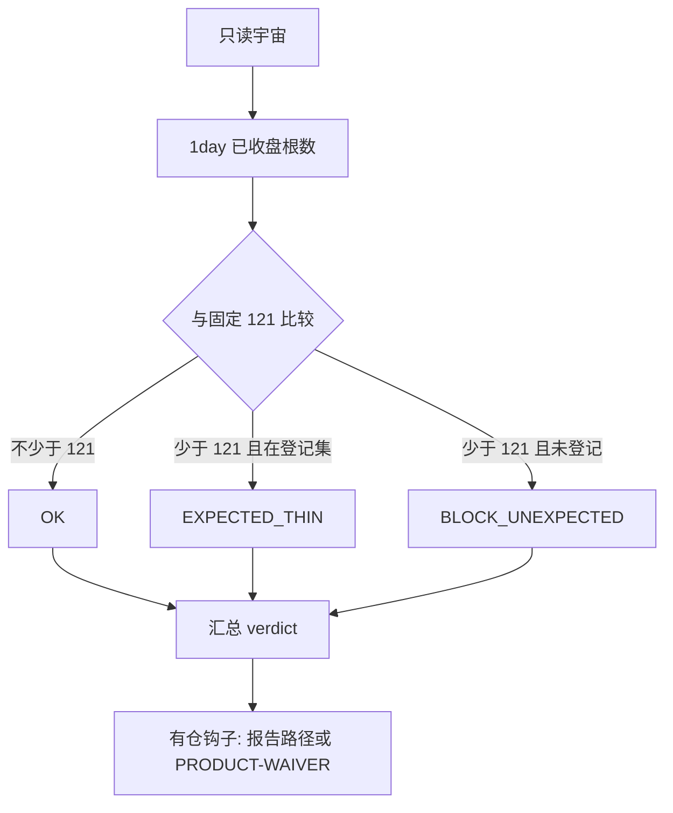

# R1-α CONTEXT 恢复常规能力（只读预检）

> 状态：交审草稿 | 日期：2026-11-02 | 读者：产品复审、运维对照
>
> 这是给热更前人工闸门用的只读工具和规程。它不装机、不热更、不改扫描池。

## 结论

日 K 深度门仍然是固定的 **121** 根已收盘 1day bar。预检只把宇宙里每个合约分成 `OK`、`EXPECTED_THIN` 或 `BLOCK_UNEXPECTED`，并给出 `PASS`、`PASS_WITH_EXPECTED_THIN` 或 `FAIL_UNEXPECTED`。

`EXPECTED_THIN` 只影响分类，不会从宇宙里删掉合约，也不会把心跳写成 `HEALTHY`。worker 心跳里的 `degraded_class` 留到 **R1-β**。本草案用「预检登记集 + 下面的对照规程」完成第一期。

## 目标与非目标

目标：

- 热更前只读核对目标宇宙的 1day `closed_bars` 相对 121。
- 用可机读 JSON 区分「登记过的薄历史」和「未登记缺口」。
- 热更脚本在动手前必须看到仓位只读报告，或带有 `PRODUCT-WAIVER` 字样的显式跳过。

非目标：

- 不修改 `required_bars`，也不提供把 121 调低的参数。
- 不写 `HTX_TREND_CONTRACTS`，不自动踢池，不写黑名单。
- 不合成 K 线，不用更低周期冒充 1day。
- 不自动平仓、减仓，不改杠杆和名义。
- 不嵌进 `LiveTrendWorker` 心跳，不热更 LIVE / PAPER。
- 不实现设计质询里的选项 B（有仓 soft 确认降级）。那是后续另戳，不是本文件的行为。

## 流程



登记集默认是空的。空登记集时，任何少于 121 根的合约都是 `BLOCK_UNEXPECTED`。文件里的名字只用于分类，工具不会据此改池。

## 预检命令

在 `htx-trend-python/` 下执行。`--depth-file` 适合夹具和离线证据；`--public-kline` 只读公开 1day K 线，交易开关保持关闭。两条深度来源互斥。

```bash
PYTHONPATH=src python3 -m htx_trend.tools.context_recovery_r1 preflight \
  --universe BTC-USDT,PONS-USDT,BOME-USDT,RAY-USDT,ACE-USDT \
  --depth-file tests/fixtures/context_recovery_r1/depth.json \
  --expected-thin-file tests/fixtures/context_recovery_r1/expected_thin.txt \
  --position-report tests/fixtures/context_recovery_r1/positions.json \
  --output ops/examples/preflight-universe-depth-r1a-sample.json \
  --markdown ops/examples/preflight-universe-depth-r1a-sample.md
```

夹具里的 63/73/56/79 是占位深度，用来演示四币薄历史，不是现网测量。样例报告：

- JSON：`ops/examples/preflight-universe-depth-r1a-sample.json`
- Markdown：`ops/examples/preflight-universe-depth-r1a-sample.md`

该夹具的裁定是 `PASS_WITH_EXPECTED_THIN`，`coverage_preview` 为 `1/5`。退出码 0 表示「规格上允许进入另批热更评审」，脚本本身不会热更。`FAIL_UNEXPECTED` 的退出码是 2，含义同样只是闸门，不是踢池。

从环境读宇宙时用 `--from-env`。实现只调用映射的读取接口，不写回环境变量，也不改 env 文件。

公开行情：

```bash
PYTHONPATH=src python3 -m htx_trend.tools.context_recovery_r1 preflight \
  --from-env \
  --public-kline \
  --expected-thin-file tests/fixtures/context_recovery_r1/expected_thin.txt \
  --output /tmp/preflight-universe-depth.json \
  --markdown /tmp/preflight-universe-depth.md
```

拉取页大小固定，不能当成更低的 121 门槛。未收盘的日 K 会按运行时同一套 `completed_candles` 丢掉，缺的根数不会被补上。

每行字段：`symbol`、`closed_bars_1d`、`required_bars_1d`（恒为 121）、`depth_class`、`has_open_position`。没有仓位报告时，仓位列是 `unknown`，不会猜成空仓或有仓。

## 健康分层对照

第一期不改 worker。扫描失败串的形状仍是 `合约:CONTEXT_UNAVAILABLE`。对照时要用截断前的完整 failures。心跳 detail 在失败超过 8 条，或详情超长时，不会保留全集。

```bash
PYTHONPATH=src python3 -m htx_trend.tools.context_recovery_r1 classify-health \
  --failures-file tests/fixtures/context_recovery_r1/failures-expected.json \
  --expected-thin-file tests/fixtures/context_recovery_r1/expected_thin.txt
```

| degraded_class | 条件 | 软验收 |
| --- | --- | --- |
| `HEALTHY` | 没有 failure，且进程仍在 | 不需要 |
| `DEGRADED_EXPECTED_THIN` | 每条 failure 都是登记合约上的 `CONTEXT_UNAVAILABLE` | `soft_accept=true`，字面仍不是 `HEALTHY` |
| `DEGRADED_UNEXPECTED` | 有未登记合约，或失败类型不是 `CONTEXT_UNAVAILABLE` | `soft_accept=false`，不得自动过 |
| `UNHEALTHY` | 进程已不在 | `soft_accept=false` |

`PASS_WITH_EXPECTED_THIN` 之后，只有 failures 全部落在这次预检的 `EXPECTED_THIN` 集里，才按上表做软验收。出现集外失败就停在 `DEGRADED_UNEXPECTED`，等产品另裁。

## 有仓守护

热更执行器不在本工具里。真正切机前单独跑钩子。默认没有仓位报告就拒绝；`--allow-skip-positions` 单独出现也拒绝。waiver 文本里必须有字面量 `PRODUCT-WAIVER`。

```bash
PYTHONPATH=src python3 -m htx_trend.tools.context_recovery_r1 position-guard \
  --position-report tests/fixtures/context_recovery_r1/positions.json
```

钩子的结果里 `auto_close` 和 `auto_reduce` 固定为 false。有仓继续由现有管仓路径处理；无仓的 CONTEXT 缺口只进入上面的监控对照。两条都不从扫描池删除。

## R1-β 债

1. 把 `degraded_class`、`expected_thin_symbols`、`unexpected_failures` 写进 `LiveTrendWorker` 心跳。现有 `WorkerHealth.status` 仍只使用既有的 `HEALTHY` / `DEGRADED`。禁止把 `DEGRADED_EXPECTED_THIN` 写成 `HEALTHY`。
2. 对照必须使用截断前的完整 failures。不能把心跳里前 8 条 `failures=` 当成全集。
3. 进 worker 的登记集只能是只读文件。不得写 `HTX_TREND_CONTRACTS`，不得因此改扫描池。
4. 设计质询选项 B（有仓时 1day 确认窗不足仍继续 soft 管仓，且无仓 CONTEXT 不再把整机打成 DEGRADED）另戳。本 PR 不改 `position_manager`，也不从 `failures` 里拿掉无仓 CONTEXT。

## 验证

```bash
cd htx-trend-python
python3 -m pytest tests/test_context_recovery_r1.py -q
```

覆盖规格 P1–P4、H1–H2、C1，以及 120/121 边界、空宇宙、公开 K 线不补 bar。

## 进度记录 — 2026-11-02

### 本次目标

把 R1-α 收成可交审的只读预检、健康对照和有仓钩子。

### 已完成

- 预检库与 CLI：`src/htx_trend/context_recovery.py`、`src/htx_trend/tools/context_recovery_r1.py`
- 单测：`tests/test_context_recovery_r1.py`
- 有仓钩子默认拒绝跳过

### 未做

- 未把分层字段嵌进 worker 心跳。原因：心跳 detail 有 1024 字截断，且改 `LiveTrendWorker.tick` 会碰到实盘路径。这是 R1-β，不是漏做的踢池。
- 未热更、未改池、未改 121。
- 未做选项 B 的 soft 管仓降级。

### 关键决策

- 121 写成代码常量，CLI 不接收覆盖参数；深度文件里如果出现 `required_bars` 键，直接拒绝。
- `PASS_WITH_EXPECTED_THIN` 用退出码 0，失败语义放在 `preflight_verdict` 字段里，避免把合法薄历史伪装成脚本故障，也不把它伪装成 `HEALTHY`。
