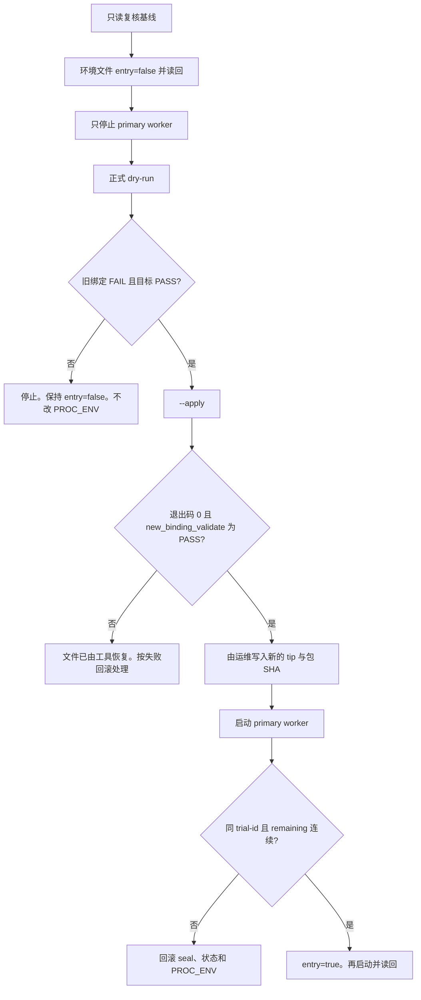

# 同 trial-id SBOX reseal 操作手册

> 状态：已定稿　|　日期：2026-11-04　|　读者：材料 ACCEPT 之后的运维
> 相关： [TRIAL-CONTROLS.md](TRIAL-CONTROLS.md)、[SBOX-LIVE.md](SBOX-LIVE.md)

本手册只交付同一次试运行的正式重封。它不给现网下命令，不改 PROC_ENV，也不宣布 σ_d 或 ORDERPX 过闸。

## 1. 结论

已激活的 `primary-15m-sbox-20261104-5fd066de` 不能换新 trial-id，也不能手改 `seal_hash`。官方入口只重写 seal 和 trial 状态里的 `source_commit` 与 `package_sha256`，然后走现有 `admission.seal` 与 `trial_admission.validate`。

目标绑定：

| 项 | 值 |
| --- | --- |
| trial-id | `primary-15m-sbox-20261104-5fd066de` |
| source_commit | `f57c409f816092c306cefb44a71769d41a8814b6` |
| package_sha256 | `f9557fd2d6fedeeec701b6010217200fc1fcfdecf5a817dc69b2e7626392070b` |
| permission | `TRIAL` |
| formal_admission | `NOT_ELIGIBLE` |
| candidate | `SBOX_FACTS_CONSERVATIVE_V1` |

`SBOX_V1_20261104` 是包的 selection 元数据，不是 seal 字段。本工具不改它，也不重打包。

签发路径是 `htx_trend.admission.seal`：对去掉 `seal_hash` 后的 canonical JSON 做 SHA-256。现有 trial seal 检测的是字节被改，不是另一把 HMAC 密钥。不要另找密钥文件，也不要把 `seal_hash` 抄进 JSON。

## 2. 期限规则：保留，不重算

`expires_rule = preserve`。

- seal 的 `issued_at`、`expires_at` 原样复制。
- trial 状态的 `started_ms`、`expires_ms`、`intents`、`limits`、`stop_reason` 原样复制。
- `remaining_ms` 仍是 `expires_ms - now`。完成笔数与占用槽位也不改。
- 不把窗口重新设成「现在起 24 小时」，不加 `duration_ms`。

`validate(..., entry=True)` 仍检查原 seal 窗口。窗口已过则工具失败退出，且不写文件。这不是续期工具。

## 3. 入口与校验和

在包含本变更的检出目录里，于 `htx-trend-python/` 下执行：

```sh
sha256sum -c release/evidence/sbox-sameid-reseal-f57c409f-SHA256SUMS.txt
```

通过后才继续。两个文件的 SHA-256：

| 文件 | SHA-256 |
| --- | --- |
| `src/htx_trend/realtime/trial_reseal.py` | `0986dc15987cb7e9b8a0a86e4c76c8de57f5c825e01b76d382a94e27953b099a` |
| `release/reseal_same_trial.py` | `e02713bc4a30ba69a60e4bd8169ace9b9cab4590f95c63fd45c7d554999e7a8f` |

操作入口：

```sh
python3 release/reseal_same_trial.py --help
```

等价模块入口是 `python3 -m htx_trend.realtime.trial_reseal`。包装脚本会把 `src` 放进 `sys.path`。不要手抄片段去改 JSON。

工具只读取环境文件里的三个键，其它行（包括数据库口令和 API secret）不进入 stdout/stderr：

- `HTX_RT_ENTRY_ENABLED`：执行前必须是精确字符串 `false`
- `HTX_PYTHON_SOURCE_COMMIT`
- `HTX_PYTHON_PACKAGE_SHA256`

`proc_env_mutated` 恒为 false。工具不写环境文件，不调用 SSH，不调用 systemctl。

## 4. 安全窗口



材料 ACCEPT 之前停在这里，不要执行第 5 节的现网命令。

只停止 `htx-trend-worker@htx-trend-live-primary`，用来放开 writer lock `coinstrategy:htx:trend:writer:v1`，并让进程真正离开 `entry=true`。PAPER-4H（PID 705510）保持运行。锁拿不到时中止本次 reseal，不要为了拿锁去停 PAPER-4H。

`--mysql --apply` 和 `--mysql --rollback` 才会获取这把锁。dry-run 不拿锁。用来授权 apply 的那次 dry-run 必须发生在 primary 已停止之后，避免状态在预览和写入之间变化。

## 5. 材料 ACCEPT 之后的步骤

下列路径以签发脚本当时使用的状态目录为例。执行前用只读的 `systemctl show` 核对 primary 单元真正加载的 `EnvironmentFile`，不一致就以单元为准，不要猜。

```text
/opt/coinstrategy/htx-trend-py-state/sbox-20261104-5fd066de/runtime.env
/opt/coinstrategy/htx-trend-py-state/sbox-20261104-5fd066de/trial-approval.json
```

数据库环境沿用 primary worker 已有的 `COINSTRATEGY_DB_HOST`、`COINSTRATEGY_DB_DATABASE`、`COINSTRATEGY_DB_USER`、`COINSTRATEGY_DB_PASSWORD`。口令只留在环境里，不要写进命令行。

### 5.1 只读复核

核对 MainPID、包 SHA、trial-id、seal 的 `source_commit` / `package_sha256`、PROC_ENV 生效值、`entry`、PAPER-4H 仍是原 PID。此时 seal 和 PROC_ENV 仍应是旧 tip `5fd066de4b44c1e6de77120abfb163150bebd006` 与包 SHA `107302a4a436eac8cbe47d5d825e9d36337273e9255b51a8018c96ae5d413150`。

### 5.2 关闭新开仓并停 primary

把 primary 的环境文件设为 `HTX_RT_ENTRY_ENABLED=false` 并读回。然后只停止 primary 单元。PAPER-4H 不动。

### 5.3 现网 dry-run

在 `htx-trend-python/` 下：

```sh
python3 release/reseal_same_trial.py --dry-run \
  --trial-id primary-15m-sbox-20261104-5fd066de \
  --source-commit f57c409f816092c306cefb44a71769d41a8814b6 \
  --package-sha256 f9557fd2d6fedeeec701b6010217200fc1fcfdecf5a817dc69b2e7626392070b \
  --approval /opt/coinstrategy/htx-trend-py-state/sbox-20261104-5fd066de/trial-approval.json \
  --runtime-env /opt/coinstrategy/htx-trend-py-state/sbox-20261104-5fd066de/runtime.env \
  --mysql
```

退出码必须是 0，并且同时满足：

- `pre_reseal_against_target` = `FAIL`（`binding mismatch: source_commit`）
- `old_binding_validate` = `FAIL`
- `new_binding_validate` = `PASS`
- `trial_id` 不变
- `applied` = false
- `expires_rule` = `preserve`
- `permission` = `TRIAL`，`formal_admission` = `NOT_ELIGIBLE`

任一不满足：停止。不要 `--apply`，不要改 PROC_ENV，保持 `entry=false`。

`--state-json` 只用于本地夹具。现网禁止用它代替 `--mysql`，否则数据库里的 binding 不会更新，worker 重启时会报 trial identity mismatch。

### 5.4 正式 reseal

命令与上一节相同，仅把 `--dry-run` 换成 `--apply`。工具会：

1. 在 approval 同目录写下 `reseal-backup-<时间>/`（原 approval、原 state、manifest）。
2. 用 `seal()` 重写 approval，模式 `0600`。
3. 再次 `validate`。通过后才把状态里的两个绑定字段改掉，并把 `revision` 加 1。
4. 状态写入失败时，把 approval 字节恢复成备份。

记下 stdout 里的 `backup_dir` 和 `seal_hash`。这个 `seal_hash` 是内容摘要，不是密钥。不要手抄它去改文件。

### 5.5 对齐 PROC_ENV

工具不会改环境。由运维把生效值写成：

```text
HTX_PYTHON_SOURCE_COMMIT=f57c409f816092c306cefb44a71769d41a8814b6
HTX_PYTHON_PACKAGE_SHA256=f9557fd2d6fedeeec701b6010217200fc1fcfdecf5a817dc69b2e7626392070b
HTX_RT_ENTRY_ENABLED=false
```

历史重复行可以留着，但生效值必须是上面两行。然后启动 primary。`trial_ops status` 的 trial-id 必须仍是原值，`activated` 为 true，`remaining_ms` 相对 reseal 前的 `expires_ms` 连续，而不是被重置成 24 小时。

### 5.6 恢复开仓

worker 健康之后，把 `HTX_RT_ENTRY_ENABLED=true` 写入环境文件，再启动一次并读回 true。窗口内允许短暂 false。PAPER-4H 的 PID 仍不得变化。COS 归档若未被这次重封破坏，记「维持」；若需要重验，另出 VERIFIED。本步骤不是 σ_d，也不是 ORDERPX≥200。

## 6. 失败回滚

| 失败点 | 动作 |
| --- | --- |
| dry-run 不是「旧 FAIL / 新 PASS」 | 不 apply。不改 PROC_ENV。primary 可按旧绑定、`entry=false` 启动。 |
| `--apply` 非 0 | 工具已把 approval 恢复为 apply 前字节。不要改 PROC_ENV。不要 `--rollback` 去「再修一次」。保持 `entry=false`，按旧绑定启动 primary。 |
| apply 已成功，但启动后不健康或 validate 不再 PASS | 保持 `entry=false`。若 PROC_ENV 已改成新 tip，先改回旧 tip 与旧包 SHA。确认状态里除 `source_commit`、`package_sha256`、`revision` 外没有新的成交变化，然后执行下面的 rollback。 |
| rollback 拒绝，因为 revision 或 intents 已继续前进 | 停止自动回滚。保留 primary 为 `entry=false`，把 backup 目录和 status 留给下一次裁决。不要手改 JSON，不要换 trial-id。 |

成功 apply 之后的回滚命令：

```sh
python3 release/reseal_same_trial.py --rollback \
  --trial-id primary-15m-sbox-20261104-5fd066de \
  --approval /opt/coinstrategy/htx-trend-py-state/sbox-20261104-5fd066de/trial-approval.json \
  --runtime-env /opt/coinstrategy/htx-trend-py-state/sbox-20261104-5fd066de/runtime.env \
  --backup /绝对路径/reseal-backup-时间戳 \
  --mysql
```

rollback 只接受这份备份对应的同一个 trial-id。磁盘上的 seal 必须仍是这次 reseal 的 `new_seal_hash`，状态也必须只差这两个绑定字段。它会把 approval 恢复成备份字节，并把状态 binding 写回旧 tip，同时把 `revision` 再加 1，避免覆盖后来的写入。

回滚完成后，PROC_ENV 生效值必须回到旧 tip / 旧包 SHA，`entry` 保持 false，直到另一次材料裁决。

## 7. 明确禁止

- 禁止手改 `trial-approval.json` 或 `seal_hash`。
- 禁止换 trial-id，禁止用新 ID 续期。
- 禁止删掉 `validate`，禁止忽略 `binding mismatch`。
- 禁止在 `HTX_RT_ENTRY_ENABLED` 不是 `false` 时 reseal。
- 禁止本工具或本手册去 SSH、热更新、改池、重打 LIVE 包、动 PAPER-4H。
- 禁止把 `release/evidence/sbox-sameid-reseal-f57c409f/` 拷到主机上当正式 seal。那是本地夹具，确认文案是合成的，除 tip 和包 SHA 外的指纹是占位符。
- 禁止把本次 reseal 说成 σ_d 或 ORDERPX 过闸。

## 8. 已提交的本地干跑

夹具目录：`release/evidence/sbox-sameid-reseal-f57c409f/`。说明见该目录的 `LOCAL-FIXTURE.txt`。

复现：

```sh
python3 release/reseal_same_trial.py --dry-run \
  --trial-id primary-15m-sbox-20261104-5fd066de \
  --source-commit f57c409f816092c306cefb44a71769d41a8814b6 \
  --package-sha256 f9557fd2d6fedeeec701b6010217200fc1fcfdecf5a817dc69b2e7626392070b \
  --approval release/evidence/sbox-sameid-reseal-f57c409f/trial-approval.json \
  --state-json release/evidence/sbox-sameid-reseal-f57c409f/trial-state.json \
  --runtime-env release/evidence/sbox-sameid-reseal-f57c409f/runtime.env \
  --now 2026-11-04T07:30:00+00:00
```

结果文件 `dry-run.json`：

- 旧 tip `5fd066de4b44c1e6de77120abfb163150bebd006` / `107302a4…13150`：`pre_reseal_against_target=FAIL`，`old_binding_validate=FAIL`，错误是 `trial approval binding mismatch: source_commit`。
- 目标 tip `f57c409f816092c306cefb44a71769d41a8814b6` / `f9557fd2…070b`：`new_binding_validate=PASS`。
- `applied=false`。没有 SSH，没有写 PROC_ENV。

夹具里的 `seal_hash` 不是现网 seal。现网以第 5.3 节对真实 approval 的 dry-run 为准。
