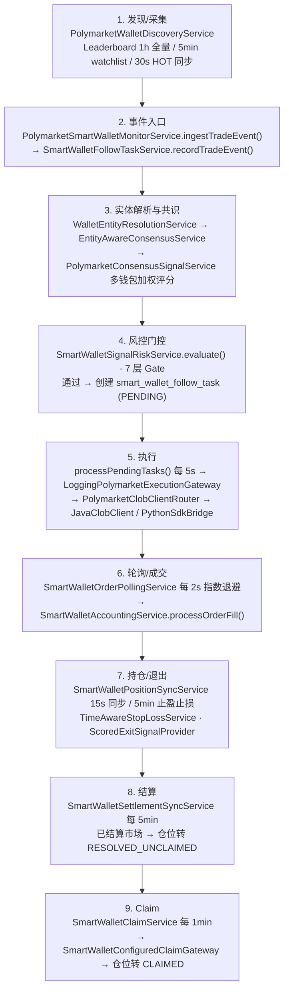

# Polymarket 跟单系统 · 现行架构（权威入口）

> **本文定位**：这是 Polymarket 跟单系统架构的**唯一权威入口文档**。此前 `polymarket/` 下有 5 篇架构类文档视角重叠，已于 2026-05-23 整合 —— 本文沉淀「系统现在长什么样」的统一口径，原 5 篇保留为历史设计稿 / 深度参考（见下方「一、文档地图」）。
>
> 如需了解某一层的深度细节，仍按本文指引去对应原文档查阅；如各文档口径冲突，**以本文为准**（冲突点已在「七、关键口径澄清」逐条裁定）。

返回 [Polymarket 知识地图](../docs/MOC-Polymarket.md) ｜ [架构与平台 知识地图](../docs/MOC-架构与平台.md)

## 一、文档地图

整合前的 5 篇文档各有侧重，现统一定位如下：

| 文档 | 定性 | 何时查阅 |
| --- | --- | --- |
| [POLYMARKET_ARCHITECTURE_ANALYSIS.md](POLYMARKET_ARCHITECTURE_ANALYSIS.md) | **逐文件源码现状分析**，最新、最贴近真实代码（基线 2026-04-26，含 05-23 核验更正） | 想知道某能力由哪个类/方法实现、字段名是什么 |
| [MVP_ARCHITECTURE.md](MVP_ARCHITECTURE.md) | **目标架构设计稿** —— 量化策略平台 MVP 演进蓝图（模型多为「待补齐」） | 想知道架构该往哪里演进、平台级模型如何设计 |
| [README-polymarket-architecture-comparison.md](README-polymarket-architecture-comparison.md) | **规划 vs 实现对比报告**（2026-04-10，口径偏旧） | 想了解早期一轮「对照规范修复」的结论 |
| [polymarket_quant_system.md](polymarket_quant_system.md) | **Polymarket 官方 API 规范参考**（Gamma / CLOB / Data API、签名、限频） | 对接 Polymarket 接口、查 API 层规范时 |
| [polymarket_arbitrage_system_design.md](polymarket_arbitrage_system_design.md) | **独立业务线设计稿** —— Yes/No 双边对冲套利，与跟单主线不是同一套模型 | 评估对冲套利方向时（注意：非当前主线实现） |

本文聚焦**智能钱包跟单**这条已落地的主线。对冲套利（第 5 篇）是另一套业务模型，类名与主线无对应，属早期分支设想。

## 二、模块结构

当前实际 Maven 模块（依赖方向：`web → job → core → common`，`web → common`）：

`coin-strategy-common` —— 基础设施共享层，已拆为四个子模块：`common-model`（Entity 实体类、枚举）、`common-dao`（MyBatis-Plus Mapper 层）、`common-api`（统一接口，如 `OrderStatus`、`UnifiedOrder`、`ITradeService`）、`common-client`（交易所客户端：Binance / OKX / Gate / Sunwk）。

`coin-strategy-core` —— 策略内核与领域抽象层。当前仅有较薄的 `Strategy.java`，是后续要补足的部分。

`coin-strategy-job` —— **核心业务逻辑所在（运行面）**：调度、拉数、信号生成、跟投、执行、结算、分析。当前几乎全部能力集中在 `smartwallet` 大包下。

`coin-strategy-web` —— 产品面 / BFF 层，已是独立 Spring Boot 应用，内部按领域拆出多个本地 BFF Controller。

约定演进方向：`core` 补足策略内核抽象、`job` 按领域（`signal` / `follow` / `execution` / `settlement` / `risk` / `analytics` / `marketdata`）拆包、`common` 收敛为纯基础设施。详见 MVP_ARCHITECTURE.md 第 16 章「演进顺序」。

## 三、业务流程

智能钱包跟单的端到端主链路（现状真实代码流）：

七层风控 Gate（`SmartWalletSignalRiskService.evaluate()`，1000+ LOC）依次为：钱包质量 → 信号新鲜度 + 流动性 → 资金约束 → 市场状态 → 共识评分 → 集中度（HHI / CR1）→ 盈利性 + Kelly 仓位。任一层不过即拒，并记录 `firstRejectGate`。

执行分 PAPER / LIVE 两路，同表存储、靠 `execution_mode` 字段隔离；LIVE 经 `PolymarketClobClientRouter` 在 Java 原生客户端 `PolymarketJavaClobClient`（EIP-712 签名）与 `PolymarketPythonSdkBridge` 之间路由。

## 四、核心数据模型

**现状已落地实体**（`common-model`，对应 `smart_wallet_*` 表）：`SmartWalletProfileEntity`（钱包画像 / 评分 / HOT-WARM-COLD 分层）、`SmartWalletTradeEventEntity`（leader 链上交易事件，跟单信号来源）、`SmartWalletFollowTaskEntity`（跟单任务状态机）、`SmartWalletOrderEntity`（本系统订单，`execution_mode` 区分 PAPER/LIVE）、`SmartWalletFillEntity`（成交明细）、`SmartWalletPositionEntity`（持仓）、`SmartWalletCashLedgerEntity`（现金流水账本）、`SmartWalletMarketInfoEntity`（市场元数据中心表，含 tokenId / indexSet / lifecycle / resolvedOutcome）、`SmartWalletSettlementRunEntity`（结算批次）、`SmartWalletBehaviorProfileEntity`（行为画像 / 原型）、`SmartWalletOrderAnalysisEntity`（订单 PnL 归因）、`WalletEntityMapEntity`（钱包→实体映射）、`WalletEntityFeatureSnapshotEntity`（实体级聚合快照）、`WalletFollowCandidateEntity`（跟单候选记录），以及 `SmartWalletDailyReportEntity`、`SmartWalletMarketSnapshotEntity` 等。

**MVP 规划、尚未落地的平台级模型**（见 MVP_ARCHITECTURE.md §5 / §11）：`StrategyProduct`、`StrategyRun`、`TradingSignal`（统一标准化信号）、`FollowSubscription`（用户-策略订阅）、`FollowOrder`（用户侧跟投订单）、`ProfitSettlement`（已实现盈利结算单）、`user_strategy_hwm`（单策略高水位）、`billing_ledger`，以及三类看板快照表 `platform_daily_snapshot` / `strategy_daily_snapshot` / `user_daily_snapshot`。

## 五、当前实现状态与已知缺口

**已完整实现**：排行榜发现、钱包评分、行为画像 / 原型分类、实体去重聚类、共识评分、七层风控、入场策略路由、Kelly 仓位、PAPER 与 LIVE CLOB 执行（EIP-712 + Python SDK 桥）、订单轮询、时间分层止损 / 评分退出 / 止盈、结算同步、Claim（含 MANUAL_CONFIRM / RELAYER / SIMULATED 多模式）、资金账本、市场元数据三级缓存、集中度风控、交易效果标签、归因分析、健康监控、数据恢复 / 重置、回放回测。

**规划未落地**：MVP 提出的平台级语义层 —— 统一 `TradingSignal` 信号层、`FollowSubscription` 订阅关系层、`ProfitSettlement` 平台分润结算层（含高水位）、三类看板快照表；以及 `core` 策略内核抽象、`job` 按领域分包、`web` 三组产品接口（`StrategyController` / `PortfolioController` / `SubscriptionController`）。

**已知风险点**（详见 POLYMARKET_ARCHITECTURE_ANALYSIS.md 第六部分）：

- 🔴 **重复下单**：`processPendingTasks()` 为 SELECT-then-UPDATE，存在并发竞态，建议改 CAS 乐观锁。
- 🔴 **持仓状态跳变**：多任务并发修改 `Position.status`，建议加 `@Version` 乐观锁。
- 🟡 **WebSocket 未真正落地**：`PolymarketMarketDataStreamService` 仅有 `ingestMockEvent()`，未见真实 WS 连接代码，行情实际依赖 60s REST 轮询。
- 🟡 重复结算 / Claim、Oracle Pending 永不超时、集中度数据延迟、内存状态（priceHistory 等）重启丢失、`market_end_at` 缺失。
- 多实例部署需补分布式锁（如 ShedLock）。

## 六、架构演进方向

现状是「以智能钱包跟单为核心的单业务系统」，目标（MVP_ARCHITECTURE.md）是演进为「以策略为中心、支持信号 / 跟投 / 分润的量化策略平台」。关键差距是中间缺三层平台语义：统一信号层、订阅关系层、平台分润结算层。演进遵循 MVP 文档第 16 章的五步顺序：补齐 `core` 抽象 → `job` 按领域拆包 → 引入平台语义数据模型 → `web` 拆三类产品接口 → 看板查询快照化。产品定位与平台形态参见 [PRODUCT_DESIGN.md](../PRODUCT_DESIGN.md) 第 4 章。

## 七、关键口径澄清

整合 5 篇文档时发现的冲突点，统一裁定如下：

1. **WebSocket**：`quant_system` 规范主张「WS 优先」、`comparison` 称「暂不考虑 WS」、`ANALYSIS` 标注 WS 连接代码未找到。**现状结论：WebSocket 未真正实现，行情以 REST 轮询为准。**
2. **`common` 模块结构**：MVP 文档写成单一 `coin-strategy-common`；实际已拆 `common-model / -dao / -api / -client` 四子模块。**以四子模块结构为准。**
3. **业务模型**：对冲套利设计稿（`ArbitrageDetector`、Delta 中性、Web3j 直连 CTF）与跟单主线（共识信号 + 七层风控 + Follow Task）是两套不同模型，类名无对应。**套利文档定位为独立 / 历史分支，非主线。**
4. **执行层**：`comparison` 称主要走 Python 脚本桥；`ANALYSIS` 显示 `PolymarketClobClientRouter` 在 Java 原生客户端与 Python SDK 间路由、Java 签名已完整。**以 ANALYSIS 为准。**
5. **结算执行**：套利文档用 Web3j 直调合约 `redeemPositions`；现状用 `SmartWalletConfiguredClaimGateway` 多模式（含 RELAYER 无 gas）。**以现状为准。**
6. **合约地址**：CTF Exchange 为 `0x4bFb41d5...`、Conditional Token Framework 为 `0x4D97DCd9...`，二者不可混用 —— 以 `polymarket_quant_system.md` §8 的区分为准。

---

<!-- kb-backlink -->
> 本文归属：[Polymarket 知识地图](../docs/MOC-Polymarket.md) ｜ [知识库首页](../docs/知识库首页.md)
