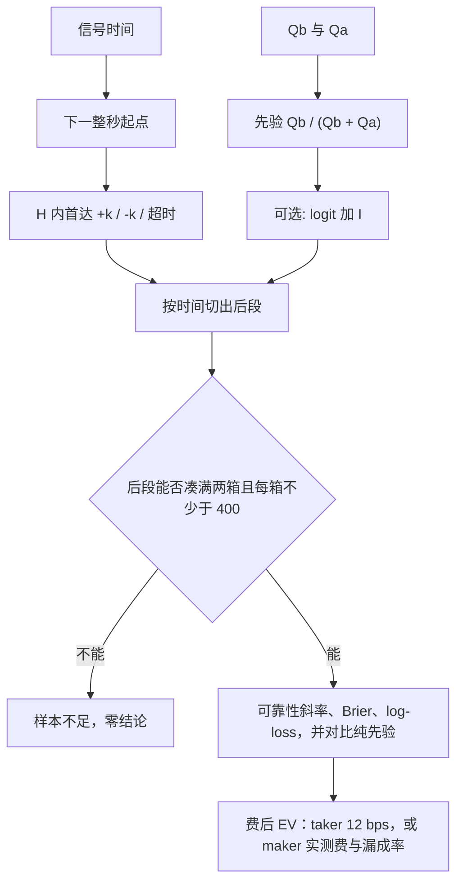

# 订单簿方向概率离线脚手架

> 状态：草稿 | 日期：2026-10-22

这是一套只在本目录运行的研究记账工具。它把预注册、首达标签、排队竞速先验、外样本校准和费后期望写成纯函数。行情文件由调用者给本地路径。本目录不连接交易所，不读密钥，不下单，也不在这里跑实验。

读者是要按同一口径复算标签和校准的人。跑通测试只说明公式和门槛按预注册执行，不说明存在可交易优势。

## 非目标

- 不采集、不补历史、不打开网络或 SSH。
- 不估计失衡系数，不搜索阈值，不把分箱门槛降到 400 以下。
- 不把「样本不足」换成一个较弱的结论。
- 不把 maker 的占位符 `measured` 换成猜测费率或猜测漏成率。
- 不产生准入、解锁或执行动作。

## 流程



依赖只有 Python 标准库。CSV 用 `csv` 读取。Parquet 仅在本机已经有 `pyarrow` 或带引擎的 `pandas` 时可读；没有引擎就停下，不安装、不下载。

在本目录运行测试：

```sh
python -m pytest tests
```

校验预注册后退出，不读行情：

```sh
python prereg.py --prereg prereg.yaml --prereg-sha "$(python -c 'import hashlib; print(hashlib.sha256(open("prereg.yaml","rb").read()).hexdigest())')"
```

哈希不一致、没传 `--prereg-sha`，或文件把分箱门槛改到 400 以下，退出码都是 2。

## 预注册

`prereg.yaml` 的原始字节 SHA256 是运行口令。`assert_prereg_sha(path, digest)` 先比对哈希，再解析同一份字节。

| 项 | 注册值 | 含义 |
| --- | --- | --- |
| `tick_size` | `0.1` | 价格格子，用十进制数，不用二进制浮点 |
| `k_ticks` | 1、2、3 | 上下障碍距离，单位是 tick |
| `horizon_s` | 5、15、30 | 窗口长度，单位是秒 |
| `start_rule` | 信号后下一整秒 | 信号在 10.0 或 10.2，起点都是 11 |
| 先验 | `Qb/(Qb+Qa)` | 买一量除以买一量加卖一量 |
| 失衡窗口 | 1、5、15 分钟 | 只允许这三档；对着同期收益残差 |
| 倾斜 | logit 加性 | `logit(p) = logit(p_up) + I` |
| 分箱 | 每箱至少 400 | 禁止降低 |
| 切分 | 按时间，训练比例 0.7 | 结论只来自后段 |
| taker | 12 bps | 写死，调用时不能改成别的数 |
| maker 费 | `measured` | 调用时另交实测数 |
| 漏成率 | `measured` | 未成交盈亏记 0，不改记成 taker |

## 标签

`first_touch_label` 的输入是起点中间价、`(时间戳, 中间价)` 路径、信号时间、k、tick 和 H。时间单位是秒。

1. 起点 = `floor(信号时间) + 1`。
2. 窗口是 `[起点, 起点 + H]`，两端都算。
3. 上障 = 起点中间价 + k × tick；下障 = 起点中间价 − k × tick。
4. 路径按时间排序。窗内第一笔大于等于上障的记 1，第一笔小于等于下障的记 -1。
5. 窗内都没碰到，记 0。起点之前和窗口之后的价格不参与。

一次只算一对 `(k, H)`。预注册里的列表由调用者自己循环，循环方式也应当写进实验记录。推荐把标签 1 映射成校准用的 y=1，把 -1 和 0 都映射成 y=0。是否丢掉超时，本工具不代劳。

## 先验

`queue_race_p_up(qb, qa)` 返回 `Qb/(Qb+Qa)`。两边都是 0，或出现负数，直接报错。

可选倾斜不在这套代码里拟合：

- `contemporaneous_return_residual` = 同期已实现收益 − 同期基准。窗口必须在信号时点已经结束，不能用首达标签。
- `tilt_from_residual(residual, scale)` 得到 `I = scale × 残差`。`scale` 由调用者按预注册传入。
- `apply_logit_tilt` 把 I 加到 logit 上。I 为 0 时概率不变。
- `validate_tilt_window` 只接受 1、5、15。

## 校准

`calibrate(y, p_model, p_prior, timestamps, train_fraction=...)` 按时间戳排序，前 `floor(n × train_fraction)` 条是训练段，其余是外样本。训练段不参与 Brier、log-loss 和分箱，也不在外样本不够时被借来凑数。

外样本按预测概率排序后，尽量切成每箱 400 条。尾部不足 400 时并入前一箱。并完后仍不足两箱，或各箱的平均预测没有差异，就返回状态 `样本不足，零结论`，箱子为空，斜率、Brier、log-loss 都是空值。`min_bin_count` 小于 400 会抛错，不会静默改用更低的门槛。

可靠性斜率是各箱「平均预测概率 → 实际频率」的普通最小二乘斜率，每箱一个点。Brier 和 log-loss 在单笔外样本上计算，log 用自然对数。同一批外样本上再算一遍纯先验，两个数都留下来，本工具不宣布谁赢。

## 费后期望

`account_ev` 的 `gross_bps` 是调用者已经按方向签好的毛收益，单位 bps。

- taker：`ev = gross - 12`。成交率记 1。传入别的 taker 费率，或非零漏成率，都会拒绝。
- maker：`ev = (1 - 漏成率) × (gross - 实测 maker 费)`。漏成的那一部分盈亏记 0。
- `maker_bps` 或漏成率是 `None` 或字符串 `measured` 时拒绝记账。负的 maker 费当作返佣保留。

恒等式是 `ev = fill_rate × (gross - fee) + miss_rate × 0`。

## 本地数据

`load_table(path)` 只接受本地 `.csv` 或 `.parquet`。`https://`、`s3://` 这类带 `://` 的路径会在打开文件前拒绝。CSV 返回字符串字段的行字典，类型转换由调用者在看见表头之后做。P2 采集如果仍是 JSONL，先在别的离线步骤里落成本地 CSV 或 Parquet，再把路径传进来。

## 文件

| 文件 | 作用 |
| --- | --- |
| `prereg.yaml` | 预注册文本 |
| `prereg.py` | 解析、SHA256 闸门、命令行入口 |
| `labels.py` | 下一整秒与首达标签 |
| `priors.py` | 排队竞速与 logit 倾斜 |
| `calibration.py` | 时间外样本分箱校准 |
| `ev.py` | 费后期望 |
| `data_io.py` | 本地只读加载 |
| `tests/` | `python -m pytest tests` |
