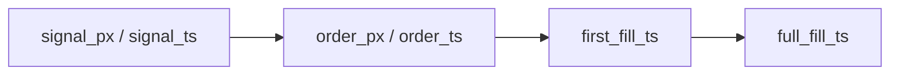

# 下单价字段迁移草案

> 状态：未执行 | 日期：2026-10-22 | 口令：MS-A-P1-ORDERPX v1.1

这份草案给以后的执行账本补可空列。本次没有改交易库，没有跑下面的 SQL，也没有回写任何历史行。研究脚本继续只读现有导出；缺字段就标 `missing_<field>`。

## 1. 背景与问题

逐笔成本要同时看到信号价、下单价和成交均价。当前只读导出（`htx-trend-python/tests/fixtures/ledger_pnl` 与合成夹具）里没有下单价来源、信号时间、撤改次数，也没有下一根 bar 的开盘价。成交均价已经在成交记录里，不能拿来填下单价。

MySQL 订单表 `htx_trend_order` 有 `request_volume`，没有委托价。SQLite `trend_order` 有 `limit_price` 和 `created_at`，没有信号价，也没有市价单下单当时的 mid / last。`average_price` 是成交均价，不是下单价。

## 2. 目标与非目标

目标：将来若要落库，只增加可空列，让新订单能记下信号价、下单价、来源和时间。历史行保持 NULL，分析侧继续标缺失。

非目标：

- 不在本次执行迁移，不改 `htx-trend-python` 的写路径。
- 不把 `next_bar_open` 放进订单表。它是研究侧下一根 bar 的开盘价，分析时另接，缺失就标 `missing_next_bar_open`。
- 不从信号价、成交价或 `average_price` 回填 `order_px`。
- 撤单次数、改单次数不用 0 当默认值。未知必须是 NULL。

## 3. 字段

| 分析字段 | 现有落点 | 草案 |
| --- | --- | --- |
| `signal_px` / `signal_ts` | 无 | 新可空列 |
| `order_px` | SQLite `limit_price`；MySQL 无 | MySQL 新可空列。限价写委托价；市价写下单时的 mid 或 last |
| `order_px_source` | 无 | `limit`、`mid` 或 `last` |
| `order_ts` | SQLite `created_at` 只表示本地建单时间 | 新可空列，记实际送单时间 |
| `order_qty` | MySQL `request_volume` | 不新加列。导出需带上该列；没有则标缺失 |
| `cancel_count` / `amend_count` | 无 | 新可空列 |
| 成交均价、成交量、手续费 | 成交表已有 | 不改 |
| 资金费 | 账本事件里的 `funding_fee_usdt` | 不新加订单列。导出没有资金费事件时标 `missing_funding`，不写成 0 |
| `next_bar_open` | 无 | 不进交易库 |



来源只允许三种：`limit` 用委托价；`mid` 用下单时盘口中间价；`last` 用下单时最新价。应用层还没改，所以这些列即使以后执行，在写路径接上之前也会一直是 NULL。

## 4. SQL 草案

下面两段都是草案，状态为未执行。禁止在 PAPER 或 LIVE 库执行，禁止用来更新历史行。

MySQL 8.0 没有 `ADD COLUMN IF NOT EXISTS`。执行前要先查 `information_schema.COLUMNS`。新列全部可空，旧插入语句可以继续跑。

```sql
-- 状态：未执行
-- 目的：MS-A-P1-ORDERPX v1.1 为 htx_trend_order 增加可空的信号价与下单价列
-- 日期：2026-10-22
-- 停服：仅可空列，按理不需要停服；仍禁止执行，直到另有口令
-- 回滚：见文末 DROP COLUMN
-- 不包含任何历史回填语句

ALTER TABLE htx_trend_order
    ADD COLUMN signal_px DECIMAL(36, 18) NULL COMMENT '信号价。禁止用成交价或下单价回填',
    ADD COLUMN signal_ts DATETIME(6) NULL COMMENT '信号时间，带时区语义由应用保证写入 UTC',
    ADD COLUMN order_px DECIMAL(36, 18) NULL COMMENT '下单价。limit 为委托价，市价为下单时 mid 或 last',
    ADD COLUMN order_px_source VARCHAR(16) NULL COMMENT 'limit、mid 或 last',
    ADD COLUMN order_ts DATETIME(6) NULL COMMENT '送单时间。不要用 created_at 代替',
    ADD COLUMN cancel_count INT NULL COMMENT '撤单次数。NULL 表示未知，不是 0',
    ADD COLUMN amend_count INT NULL COMMENT '改单次数。NULL 表示未知，不是 0';
```

SQLite `trend_order` 草案同样未执行。SQLite 每次只能加一列。

```sql
-- 状态：未执行
-- 目的：为 trend_order 补信号价、下单价来源和撤改次数
-- 日期：2026-10-22
-- 不回写已有行。limit_price 继续只表示限价委托价，不改成成交价

ALTER TABLE trend_order ADD COLUMN signal_px TEXT;
ALTER TABLE trend_order ADD COLUMN signal_ts TEXT;
ALTER TABLE trend_order ADD COLUMN order_px TEXT;
ALTER TABLE trend_order ADD COLUMN order_px_source TEXT;
ALTER TABLE trend_order ADD COLUMN order_ts TEXT;
ALTER TABLE trend_order ADD COLUMN cancel_count INTEGER;
ALTER TABLE trend_order ADD COLUMN amend_count INTEGER;
```

回滚草案，同样未执行：

```sql
-- 状态：未执行
ALTER TABLE htx_trend_order
    DROP COLUMN signal_px,
    DROP COLUMN signal_ts,
    DROP COLUMN order_px,
    DROP COLUMN order_px_source,
    DROP COLUMN order_ts,
    DROP COLUMN cancel_count,
    DROP COLUMN amend_count;
```

SQLite 不支持直接删列。若将来真的加过这些列又要撤回，需要建新表再拷贝旧列，那一步也尚未设计成可执行脚本。

## 5. 风险

- 列一旦被写成成交价，三段滑点会失真。写路径必须拒绝用 `average_price`、信号价或成交价填充 `order_px`。
- `cancel_count` 若用默认 0，缺失和“确实没撤”就分不开。所以草案不设默认值。
- 大表加列可能锁表。真要执行时另估数据量，并先在测试库验证。本次不执行，所以没有锁表风险。
